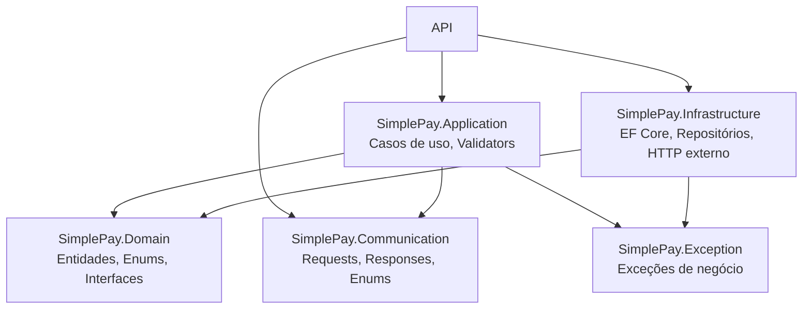
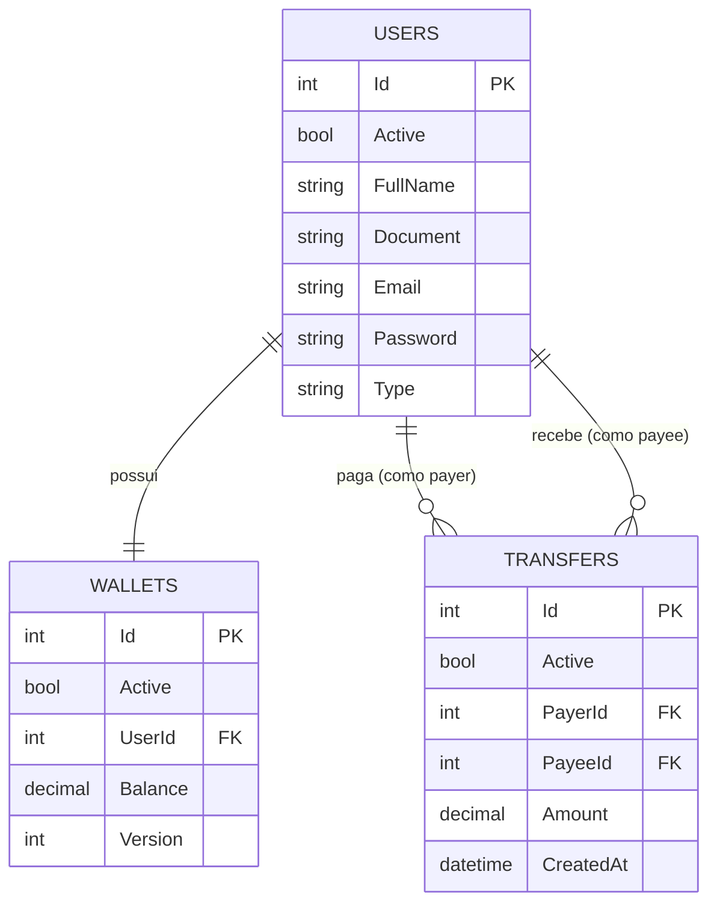

# SimplePay


API RESTful de pagamentos simplificada, construída em **.NET 10** seguindo os princípios de **Clean Architecture**. Permite registrar usuários comuns e lojistas, depositar saldo em carteira e realizar transferências entre usuários — com validação de regras de negócio, consulta a um serviço autorizador externo, transação atômica com controle de concorrência, e notificação best-effort de quem recebe o dinheiro.

## Índice

- [Stack técnica](#stack-técnica)
- [Arquitetura](#arquitetura)
- [Estrutura do banco de dados](#estrutura-do-banco-de-dados)
- [Regras de negócio](#regras-de-negócio)
- [Endpoints](#endpoints)
- [Como rodar o projeto](#como-rodar-o-projeto)
- [Decisões técnicas](#decisões-técnicas)
- [Roadmap](#roadmap)

## Stack técnica

| Camada | Tecnologia |
|---|---|
| Framework | .NET 10 / ASP.NET Core Web API |
| Banco de dados | MySQL |
| ORM | Entity Framework Core (`MySql.EntityFrameworkCore`) |
| Migrations | FluentMigrator (executadas automaticamente na subida da API, com retry) |
| Hash de senha | Argon2 (`Konscious.Security.Cryptography.Argon2`) |
| Validação | FluentValidation + validador próprio de CPF/CNPJ (dígito verificador real) |
| Mapeamento objeto-objeto | Mapster |
| Resiliência HTTP | `Microsoft.Extensions.Http.Resilience` (retry/timeout/circuit breaker nas chamadas externas) |
| Containerização | Docker + Docker Compose (API + MySQL) |

Sem autenticação/JWT — decisão deliberada, não esquecimento (ver [Decisões técnicas](#decisões-técnicas)).

## Arquitetura

O projeto é dividido em 6 projetos .NET, cada um com uma responsabilidade específica:



### O que cada camada faz, e por quê

**`Domain`** é o centro do projeto — as entidades (`User`, `Wallet`, `Transfer`), os enums, e as *interfaces* que descrevem o que o sistema precisa do mundo exterior (`IUserReader`, `IWalletWriter`, `IAuthorizerService`, `IPasswordHasher`...). Não referencia nenhum outro projeto, nem sabe que banco de dados existe, nem que a API é HTTP. É puro modelo de negócio e contratos.

**`Communication`** define o formato público da API — os `Request`/`Response` que trafegam em JSON, e cópias próprias dos enums do `Domain` (`Communication.Enums.UserType`, não o mesmo tipo de `Domain.Enums.UserType`). Também não referencia nada. A separação entre os dois existe de propósito: o contrato público da API e o modelo interno do negócio podem evoluir em ritmos diferentes sem quebrar um ao outro — por exemplo, se amanhã `Domain.Entities.User` ganhar um campo interno (um score de risco, digamos), isso não vaza pra `Communication` a menos que alguém decida explicitamente expor.

**`Exception`** é a hierarquia de erros de negócio (`ValidationException`, `NotFoundException`, `ConcurrencyConflictException`) mais as mensagens (`MessagesExceptionResource`). Também zero dependências — tanto `Application` quanto `Infrastructure` precisam lançar essas exceções, então elas moram num lugar que os dois conseguem enxergar sem depender um do outro.

**`Application`** orquestra os casos de uso (`RegisterUser`, `Deposit`, `CreateTransfer`) — é onde a regra de negócio de verdade mora: validação, sequência de passos, decisões. Depende de `Domain` (pra falar com as interfaces) e `Communication` (pra receber/devolver DTOs), mas **nunca** de `Infrastructure` — um caso de uso não sabe se os dados vêm de MySQL, PostgreSQL ou um arquivo texto, só conhece as interfaces do `Domain`.

**`Infrastructure`** é quem implementa de fato as interfaces do `Domain`: `UserRepository` fala com o EF Core, `AuthorizerService`/`NotificationService` falam HTTP com os mocks externos, `Argon2PasswordHasher` faz o hash de verdade. Esse é o único lugar do projeto que sabe que o banco é MySQL ou que a autorização é uma chamada REST.

**`API`** é a casca mais externa — Controllers, roteamento, health checks, o `Program.cs` que liga tudo via injeção de dependência. Depende de todo o resto, porque o papel dela é só **traduzir HTTP em chamadas de caso de uso** e devolver a resposta — não tem regra de negócio nenhuma aqui.

### A Regra de Dependência

Setas do diagrama só apontam pra dentro: `API` → `Application`/`Infrastructure` → `Domain`. Nunca o contrário — `Domain` não importa nada de `Application`, `Application` não importa nada de `Infrastructure`. Essa é a ideia central da Clean Architecture (e também aparece como "Dependency Rule" na Onion/Hexagonal Architecture): as camadas internas (regra de negócio) não podem depender das externas (detalhes técnicos). Na prática, isso significa duas coisas concretas:
- **Trocar o banco de dados não exige tocar em `Application` nem `Domain`.** Se amanhã o projeto migrasse de MySQL pra PostgreSQL, só `Infrastructure` muda.
- **Testar a regra de negócio não exige banco de dados nenhum.** Um teste de `CreateTransfer` pode injetar implementações falsas de `IUserReader`/`IWalletReader`/`IAuthorizerService` em memória — sem subir MySQL, sem chamar a API externa de verdade.

### Princípios SOLID aplicados

| Princípio | Onde aparece |
|---|---|
| **S** — Responsabilidade única | Cada caso de uso é uma classe só com um motivo pra mudar: `RegisterUser` só lida com registro, `CreateTransfer` só com transferência. Nenhuma classe faz duas coisas. |
| **O** — Aberto/fechado | Novas regras de validação entram como novas `RuleFor` nos `Validator`s existentes, ou como um novo `Validator`/caso de uso — sem precisar reescrever o que já funciona. |
| **L** — Substituição de Liskov | Qualquer implementação de `IWalletReader` (hoje `WalletRepository`, poderia ser uma fake em memória num teste) pode substituir a outra sem quebrar quem consome a interface. |
| **I** — Segregação de interface | `IUserReader` e `IUserWriter` são interfaces separadas (não uma `IUserRepository` única com tudo). `CreateTransfer` só injeta `IUserReader` — nunca precisa (nem consegue, por engano) chamar um método de escrita de usuário. |
| **D** — Inversão de dependência | `Application` depende da abstração `IAuthorizerService`, nunca da classe concreta `AuthorizerService` (que usa `HttpClient`). Quem decide qual implementação usar é o `DependencyInjectionExtension`, não o caso de uso. |

### Padrões de projeto identificados

- **Repository** — `IUserReader`/`IUserWriter`, `IWalletReader`/`IWalletWriter`, `ITransferWriter` abstraem o acesso a dados; `Application` não sabe que existe EF Core por trás.
- **Unit of Work** — `IUnitOfWork.Commit()` garante que múltiplas alterações (duas carteiras + um registro de transferência) sejam persistidas como uma unidade atômica só.
- **Ports & Adapters (Hexagonal)** — `IAuthorizerService`/`INotificationService` são as *portas* (definidas no `Domain`, o que o negócio precisa); `AuthorizerService`/`NotificationService` em `Infrastructure` são os *adaptadores* (como isso é tecnicamente resolvido, via HTTP).
- **Dependency Injection** — toda classe recebe suas dependências via construtor (`CreateTransfer(IUserReader userReader, IWalletReader walletReader, ...)`), nunca instancia uma dependência concreta internamente. É o que torna os outros padrões testáveis de verdade.
- **Optimistic Concurrency (token de versão)** — `Wallet.Version` como `IsConcurrencyToken()`, incrementado manualmente a cada alteração de saldo, evita *lost update* em transferências simultâneas sem precisar de lock pessimista no banco.

## Estrutura do banco de dados



### `Users`
| Coluna | Tipo | Observação |
|---|---|---|
| Id | int (identity) | PK — gerado pelo banco, não pelo cliente |
| Active | bool | soft delete |
| FullName | varchar(250) | |
| Document | varchar(20) | único — CPF (`Type = Common`) ou CNPJ (`Type = Shopkeeper`), validado por dígito verificador |
| Email | varchar(250) | único |
| Password | varchar(255) | hash Argon2 (salt + hash concatenados, base64) |
| Type | varchar(50) | `Common` ou `Shopkeeper` |

### `Wallets`
| Coluna | Tipo | Observação |
|---|---|---|
| Id | int (identity) | PK |
| Active | bool | soft delete |
| UserId | int | FK → `Users.Id`, único (relação 1:1) |
| Balance | decimal(18,2) | nunca `double`/`float` |
| Version | int | token de concorrência otimista, incrementado manualmente a cada alteração de saldo |

### `Transfers`
| Coluna | Tipo | Observação |
|---|---|---|
| Id | int (identity) | PK |
| Active | bool | soft delete |
| PayerId | int | FK → `Users.Id` |
| PayeeId | int | FK → `Users.Id` |
| Amount | decimal(18,2) | |
| CreatedAt | datetime | |

Sem coluna de `Status`: só existe uma linha aqui quando a transferência realmente aconteceu — se falhar em qualquer etapa, nada é persistido.

## Regras de negócio

**Usuários**
- Registro exige nome completo, documento (CPF pra `Common`, CNPJ pra `Shopkeeper`), e-mail e senha (mín. 8 caracteres).
- Documento validado por dígito verificador real (módulo 11), não só contagem de caracteres — rejeita `11111111111`, por exemplo, mesmo tendo 11 dígitos.
- CPF/CNPJ e e-mail únicos no sistema.
- Cada usuário nasce com uma carteira própria, saldo zero.

**Depósito**
- Valor precisa ser maior que zero.
- Soma direto no saldo da carteira do usuário informado.

**Transferência**
- Só usuários comuns podem enviar dinheiro; lojistas só recebem.
- Pagador e recebedor precisam ser usuários diferentes.
- Valor precisa ser maior que zero e não pode exceder o saldo disponível do pagador.
- Antes de confirmar, consulta um serviço autorizador externo (mock) — **fail-closed**: qualquer problema nessa consulta (erro de rede, resposta inesperada, serviço fora do ar) nega a transferência, nunca autoriza por omissão.
- Débito do pagador, crédito do recebedor e registro da transferência acontecem numa única operação atômica — tudo ou nada.
- Depois da transferência confirmada, dispara notificação ao recebedor (melhor esforço — falha na notificação nunca desfaz uma transferência já concluída).

## Endpoints

| Método | Rota | Descrição |
|---|---|---|
| POST | `/users/register` | Registra usuário (comum ou lojista) e cria a carteira |
| POST | `/wallets/deposit` | Deposita saldo na carteira de um usuário |
| POST | `/transfer` | Transfere dinheiro entre dois usuários — **contrato obrigatório do desafio** |
| GET | `/health` | Health check (API + conexão com o banco) |

`POST /users/register` e `POST /wallets/deposit` são propostas próprias (o desafio convida a isso) — sem elas não haveria como testar uma transferência de verdade, já que carteiras nascem com saldo zero. `POST /transfer` segue o contrato exato dado no enunciado (`{ "value", "payer", "payee" }`).

Um arquivo `requests.http` na raiz do repositório tem um fluxo completo pronto pra testar (registro → depósito → transferência, incluindo os principais casos de erro).

## Como rodar o projeto

### Opção A — Docker (mais rápido)

```bash
docker compose up --build
```

Sobe a API (`http://localhost:8080`) e o MySQL juntos. Migrations rodam sozinhas na subida.

Pra trocar a senha padrão do banco (só usada localmente, container efêmero):
```bash
DB_PASSWORD=sua_senha docker compose up --build
```

### Opção B — Local (.NET SDK + MySQL)

1. Pré-requisitos: [.NET 10 SDK](https://dotnet.microsoft.com/download), MySQL rodando localmente.

2. Configure os segredos locais:
   ```bash
   cp src/back/SimplePay.API/appsettings.Development.json.example src/back/SimplePay.API/appsettings.Development.json
   ```
   Edite `ConnectionStrings:DbConnection` com a sua string de conexão.

3. Rode a API:
   ```bash
   dotnet run --project src/back/SimplePay.API
   ```

## Decisões técnicas

- **IDs numéricos (`int`), não GUID.** O contrato de `/transfer` dado no desafio usa inteiros (`"payer": 4`). Mantive a mesma convenção em todas as entidades, não só `User`, pra não misturar dois estilos de chave primária no mesmo projeto sem necessidade.
- **Sem autenticação/JWT.** O contrato de `/transfer` não exige nenhum header de autenticação, e o foco declarado do desafio é no domínio de carteira/transferência. Adicionar login seria escopo não pedido.
- **Lojista usa CNPJ, usuário comum usa CPF.** O enunciado original pede "CPF" pros dois tipos, mas depois fala em "CPF/CNPJ" — interpretação mais realista e mais comum nas soluções desse desafio.
- **`Wallet` como entidade separada, não um campo em `User`.** O enunciado chama isso explicitamente de "carteira" como conceito próprio — modelar como entidade separada também abre espaço natural pra histórico de movimentações no futuro, sem precisar redesenhar nada.
- **Concorrência otimista na carteira (`Version`, incrementado manualmente).** Duas transferências simultâneas na mesma carteira poderiam causar *lost update* num `UPDATE balance = balance - X` ingênuo. Não usei o `rowversion`/`timestamp` automático do EF Core porque esse recurso é específico de SQL Server — MySQL não tem equivalente nativo, então o token de concorrência é um `int` comum, incrementado pela aplicação a cada mudança de saldo.
- **Transação sem API de transação manual.** Um único `SaveChangesAsync()` cobrindo as duas carteiras + o registro da transferência já é atômico por padrão no EF Core — não precisei de `BeginTransaction`/`Commit` explícitos pra atender o requisito de "reverter em qualquer caso de inconsistência".
- **Notificação fora da transação, com falha silenciosa deliberada.** A chamada ao serviço de notificação só acontece depois do `Commit()` já ter persistido a transferência, dentro de um `try/catch` que não propaga erro — porque o requisito avisa que esse serviço pode estar instável, e isso nunca pode desfazer dinheiro que já mudou de mão.
- **Autorizador externo fail-closed.** Qualquer falha ao consultar o serviço autorizador (timeout, erro, resposta inesperada) nega a transferência. Para um sistema de pagamento, nunca mover dinheiro sem confirmação explícita de autorização é a escolha correta, não um trade-off.
- **Validação real de CPF/CNPJ (dígito verificador).** Em vez de só checar quantidade de dígitos, implementei o algoritmo de módulo 11 de verdade — rejeita sequências como `11111111111`, que têm o tamanho certo mas são inválidas na prática.

## Roadmap

- [ ] **Testes automatizados** — unidade no `CreateTransfer` (é onde mora toda a regra de negócio) e um teste de integração fim-a-fim no `/transfer`.
- [ ] **Mock próprio do serviço de notificação** para desenvolvimento local, já que o mock público (`/api/v1/notify`) não respondeu em testes manuais.
- [ ] **Cache leve** para dados de usuário pouco mutáveis (existência/tipo), explicitamente sem cachear saldo — cachear saldo furaria a própria validação que o requisito pede.

## Licença

Este projeto está sob a licença MIT.